<picture>
  <source media="(prefers-color-scheme: dark)" srcset="assets/header-dark.svg">
  
</picture>

  I build the backend for the features players actually touch: referrals, social, messaging and sign-in. 
  <a href="https://www.linkedin.com/in/somesh-garemane"><b>LinkedIn ↗</b></a>

## Working on

<picture>
  <source media="(prefers-color-scheme: dark)" srcset="assets/working-on-dark.svg">
  
</picture>

## Toolbox

<picture>
  <source media="(prefers-color-scheme: dark)" srcset="assets/toolbox-dark.svg">
  
</picture>

## Into

Distributed systems and event-driven architecture · System design and scalable backend APIs · Fintech and payment systems
