<picture>
  <source media="(prefers-color-scheme: dark)" srcset="assets/header-dark.svg">
  
</picture>

  I build the backend for the features players actually touch: referrals, social, messaging and sign-in. 
  <a href="https://www.linkedin.com/in/somesh-garemane"><b>LinkedIn ↗</b></a>

## Now

<table>
  <tr>
    <td width="50%" valign="top">
      <h4>🎁 Referrals & growth</h4>
      Built the referral tracker: a ledger of referrals and reward bonuses with expiry, filterable history, referee search and push nudges, rolled out behind feature flags.
    </td>
    <td width="50%" valign="top">
      <h4>💬 Real-time & social</h4>
      Direct messages over WebSockets, push notifications, follower feeds and multi-language content.
    </td>
  </tr>
  <tr>
    <td width="50%" valign="top">
      <h4>🔐 Identity & sign-in</h4>
      One-tap sign-up and login with Google, Facebook and Apple, with OAuth token verification and account linking.
    </td>
    <td width="50%" valign="top">
      <h4>☁️ Platform</h4>
      Serverless Python microservices on AWS: API Gateway and Lambda, Cognito for user auth, DynamoDB for storage and SQS for async work.
    </td>
  </tr>
</table>

**Previously:** card payments end to end, including 3DS challenges, tokenised card storage, payouts, chargebacks and provider webhooks.

## Toolbox

<table>
  <tr><td><b>Language</b></td><td><code>Python</code> · <code>SQLAlchemy</code></td></tr>
  <tr><td><b>AWS</b></td><td><code>Lambda</code> · <code>API Gateway</code> · <code>Cognito</code> · <code>SQS</code></td></tr>
  <tr><td><b>Data</b></td><td><code>DynamoDB</code> · <code>PostgreSQL</code></td></tr>
  <tr><td><b>Workflow</b></td><td><code>Git</code> · <code>GitHub</code></td></tr>
</table>

## Into

Distributed systems and event-driven architecture · System design and scalable backend APIs · Fintech and payment systems
